# Numeric Clock — numeric date & time for the GNOME top bar

[](https://github.com/nickotmazgin/Linux-Numeric-Date-And-Clock/releases/latest)
[](https://github.com/nickotmazgin/Linux-Numeric-Date-And-Clock/actions)
[](https://github.com/nickotmazgin/Linux-Numeric-Date-And-Clock/releases)
[](LICENSE)
[](#compatibility)
[](#compatibility)
[](#compatibility)
[](#compatibility)

[](https://github.com/nickotmazgin/Linux-Numeric-Date-And-Clock/issues)
[](https://github.com/nickotmazgin/Linux-Numeric-Date-And-Clock/discussions)
[](https://github.com/nickotmazgin/Linux-Numeric-Date-And-Clock/stargazers)
[](https://youtu.be/VlcEy6rQHBw)
[](https://dev.to/nickotmazgin/numeric-clock-176-a-numeric-date-and-time-for-the-gnome-top-bar-now-with-gnome-51-menu-styles-51oh)
[](#features)

A lightweight **GNOME Shell extension** that turns the top-bar clock into a **numeric, fully configurable date and time** — **DD/MM/YYYY**, **ISO 8601 (YYYY-MM-DD)**, **24-hour** or **12-hour** time, with **seconds**, **weekday** or **ISO week number** — using any `strftime` format, anywhere in the world.

Stock GNOME shows `Oct 22  13:17` and offers no date-format setting. Numeric Clock shows `22/10/2026 13:17:05` (or whatever you choose), ticks exactly on the second, and puts the stock clock back the moment you disable it.

**Latest:** v17.7.0 — ESM build v32 for **GNOME 45–51** (**X11/Xorg validated** on Zorin OS 18.1 / GNOME Shell 46)

> **Demo:** [watch the 83-second tour](#demo-video) ([YouTube](https://youtu.be/VlcEy6rQHBw)) · [write-up on DEV](https://dev.to/nickotmazgin/numeric-clock-176-a-numeric-date-and-time-for-the-gnome-top-bar-now-with-gnome-51-menu-styles-51oh) · [announcement](https://github.com/nickotmazgin/Linux-Numeric-Date-And-Clock/discussions/76)

> Download [v17.7.0](https://github.com/nickotmazgin/Linux-Numeric-Date-And-Clock/releases/latest). Older stable releases are kept for rollback. See [CHANGELOG.md](CHANGELOG.md) for what changed.

**UUID:** `numeric-clock@nickotmazgin`

> **Keywords:** GNOME clock format · GNOME top bar date · numeric date · DD/MM/YYYY · ISO 8601 · 24-hour clock · seconds in top bar · week number · strftime · custom date format · GNOME Shell extension · Ubuntu · Fedora · Zorin OS · Wayland · X11 · Xorg · open source

> **GNOME Shell 42–44 is no longer supported.** Numeric Clock requires **GNOME 45–51**.

---

## Quick links

* **Latest release (ZIPs):** [GitHub Releases](https://github.com/nickotmazgin/Linux-Numeric-Date-And-Clock/releases/latest)
* **Privacy:** [PRIVACY.md](PRIVACY.md)
* **Security:** [SECURITY.md](SECURITY.md)
* **Support:** [SUPPORT.md](.github/SUPPORT.md) · **Contributing:** [CONTRIBUTING.md](CONTRIBUTING.md)
* **Issues:** [Report a bug](https://github.com/nickotmazgin/Linux-Numeric-Date-And-Clock/issues)
* **Discussions:** [Ask a question](https://github.com/nickotmazgin/Linux-Numeric-Date-And-Clock/discussions)

---

## Demo video

*Narrated tour of v17.7.0: the clock, every tray click, presets, menu styles and Preferences. Also on [YouTube](https://youtu.be/VlcEy6rQHBw).*

https://github.com/user-attachments/assets/44b9c567-c483-42f2-9d71-ffefac1fe99a

---

## Screenshots

*Numeric Clock v17.7.0 on GNOME Shell — click any image to view it full size.*

[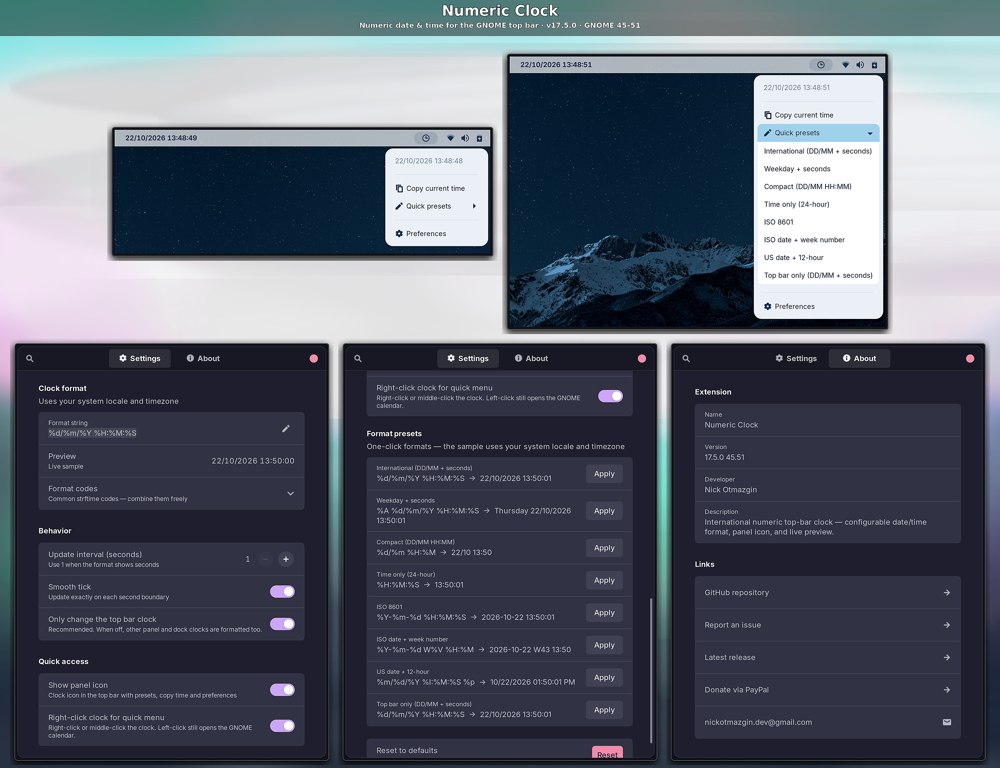](screenshots/collage.jpg)

<table>
  <tr>
    <td align="center" valign="top">
      <a href="screenshots/tray-menu.jpg">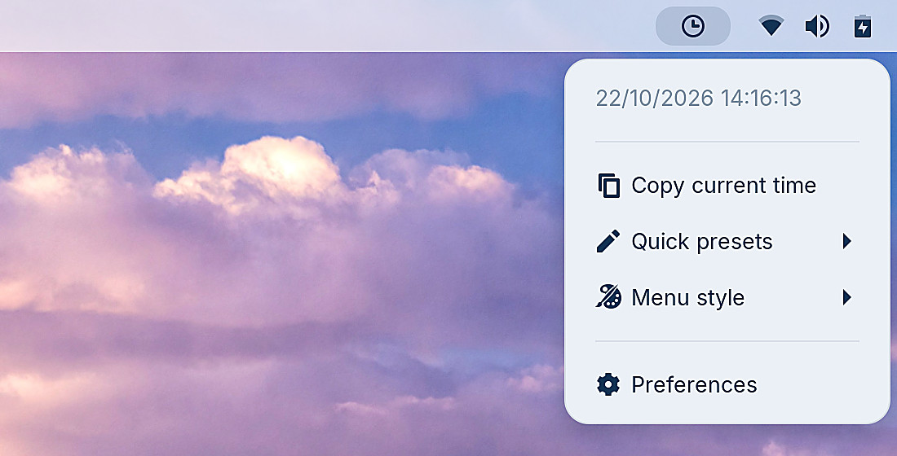</a><br>
      Panel icon — left-click quick menu with About and Donate
    </td>
    <td align="center" valign="top">
      <a href="screenshots/quick-presets.jpg">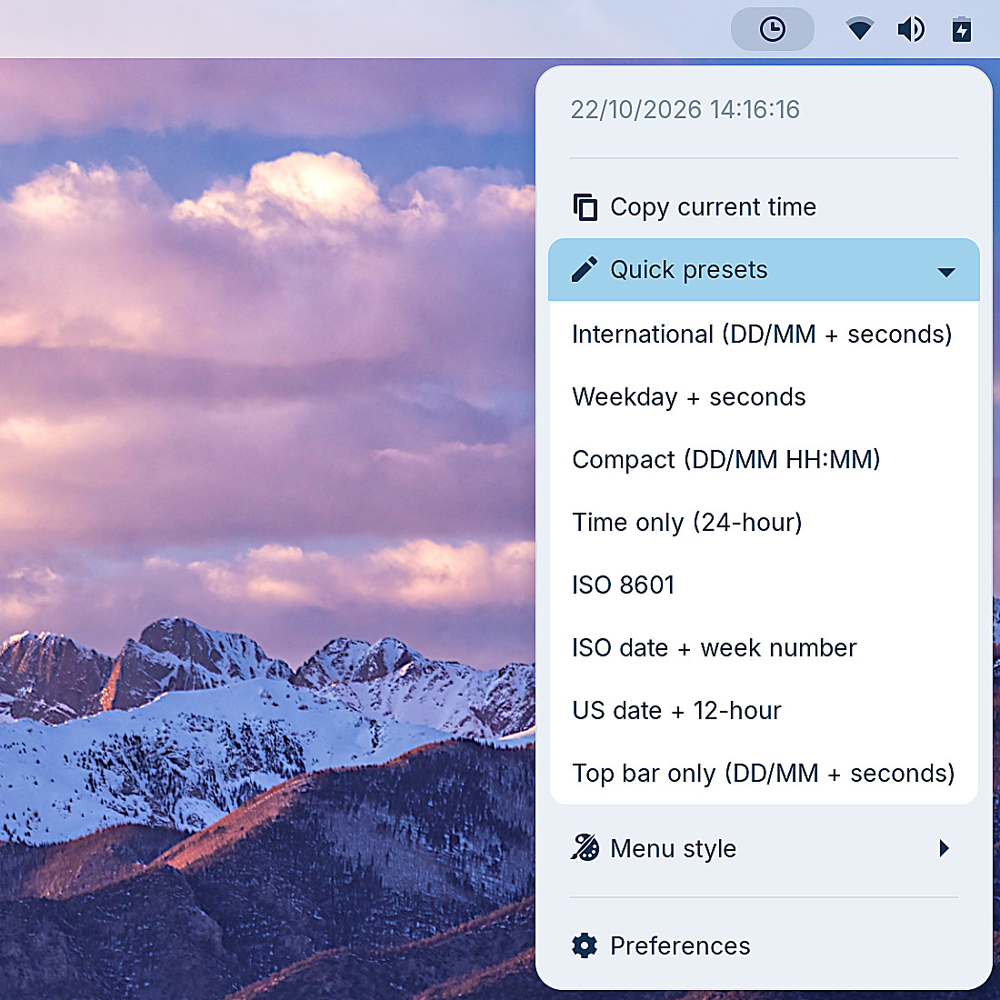</a><br>
      Quick presets
    </td>
    <td align="center" valign="top">
      <a href="screenshots/menu-styles.jpg">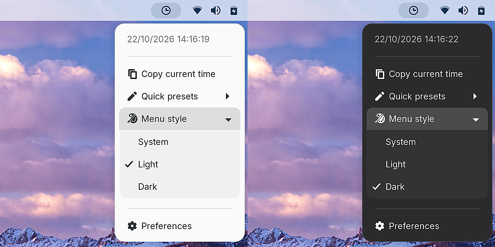</a><br>
      Menu style — Light and Dark
    </td>
  </tr>
  <tr>
    <td align="center" valign="top">
      <a href="screenshots/clock-right-click.jpg">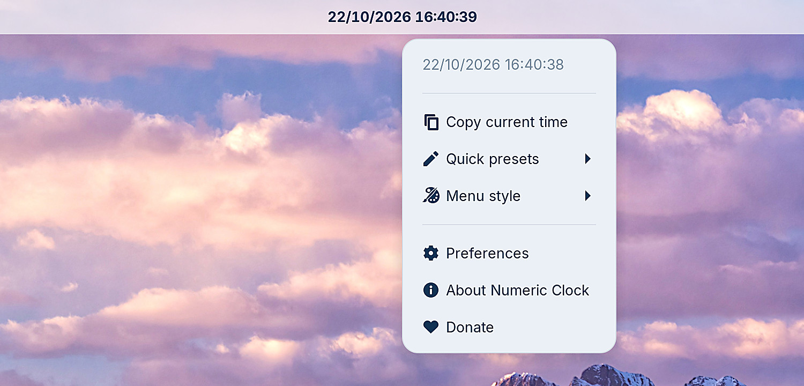</a><br>
      Right-click the clock for the same menu
    </td>
    <td align="center" valign="top">
      <a href="screenshots/tray-tooltip.jpg"></a><br>
      Hover tooltip with click hints
    </td>
    <td align="center" valign="top">
      <a href="screenshots/copy-notification.jpg">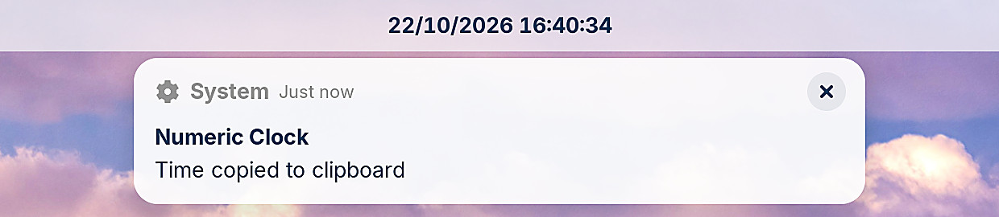</a><br>
      Middle-click copies the time
    </td>
  </tr>
  <tr>
    <td align="center" valign="top">
      <a href="screenshots/right-click-preferences.jpg">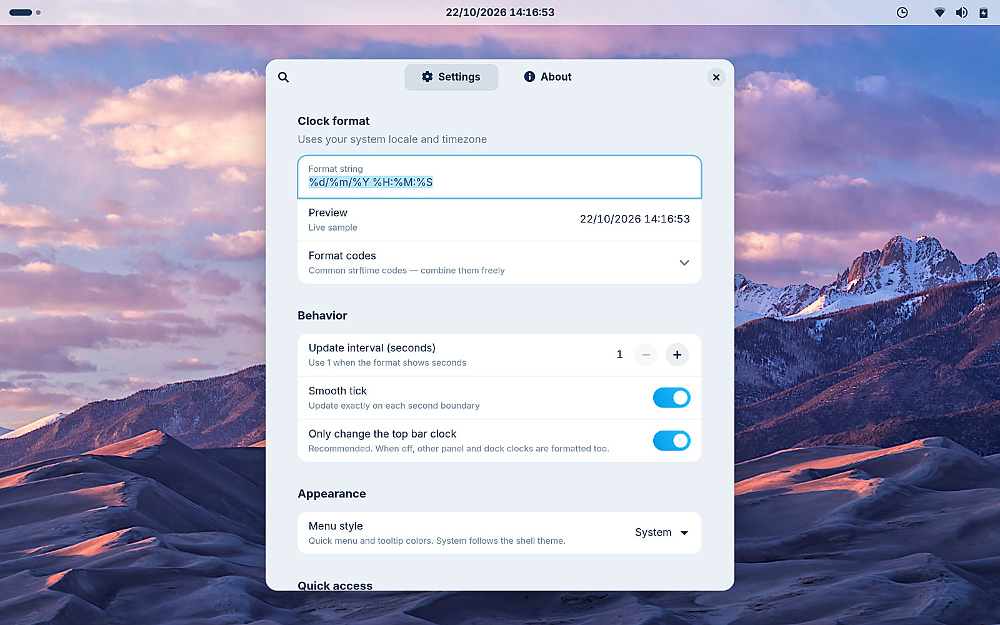</a><br>
      Right-click the icon opens Preferences
    </td>
    <td align="center" valign="top">
      <a href="screenshots/prefs-settings.jpg">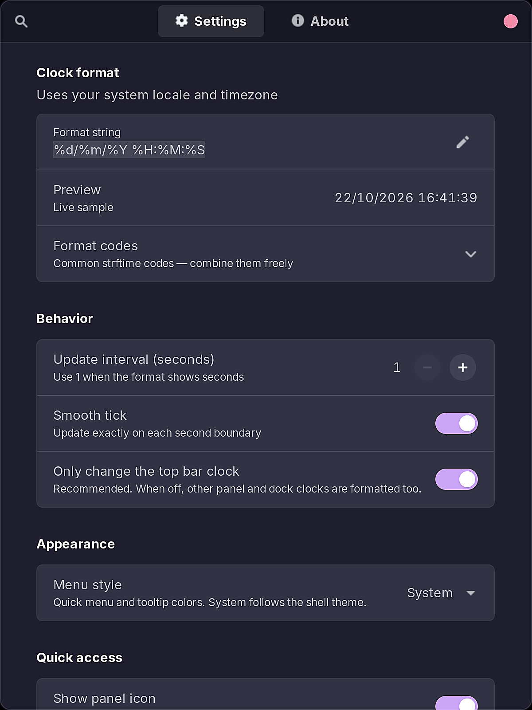</a><br>
      Preferences — clock format
    </td>
    <td align="center" valign="top">
      <a href="screenshots/prefs-appearance-clicks.jpg">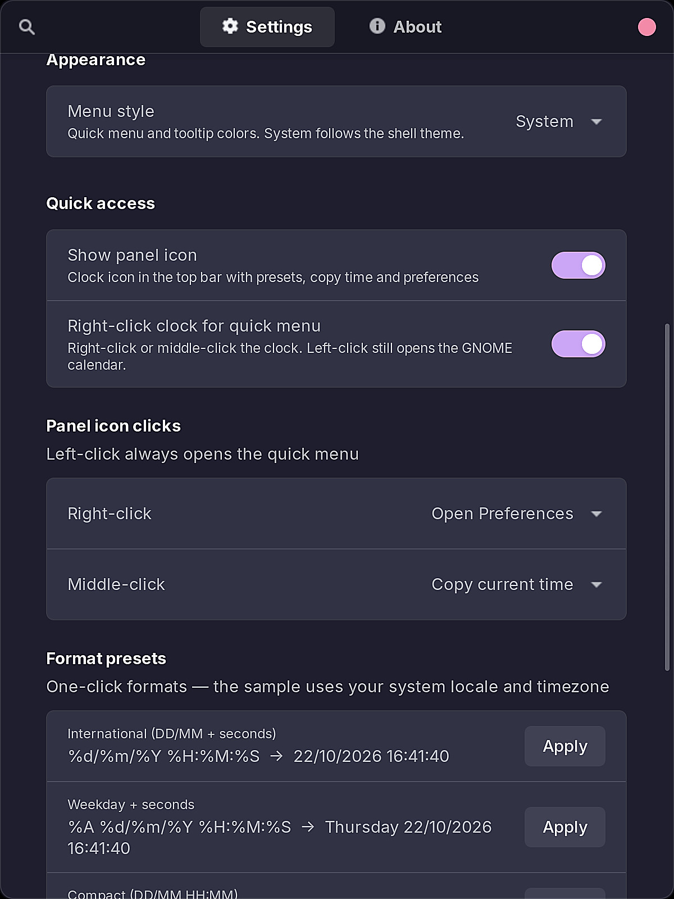</a><br>
      Appearance and panel icon clicks
    </td>
  </tr>
  <tr>
    <td align="center" valign="top">
      <a href="screenshots/prefs-presets.jpg">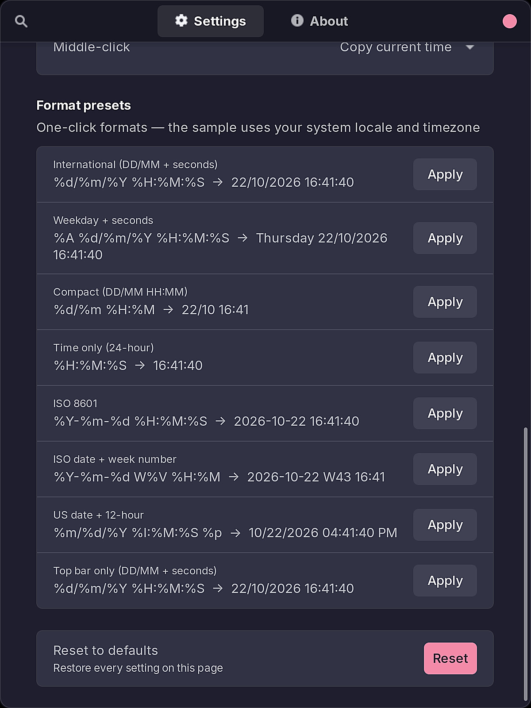</a><br>
      Format presets with live samples
    </td>
    <td align="center" valign="top">
      <a href="screenshots/prefs-about.jpg">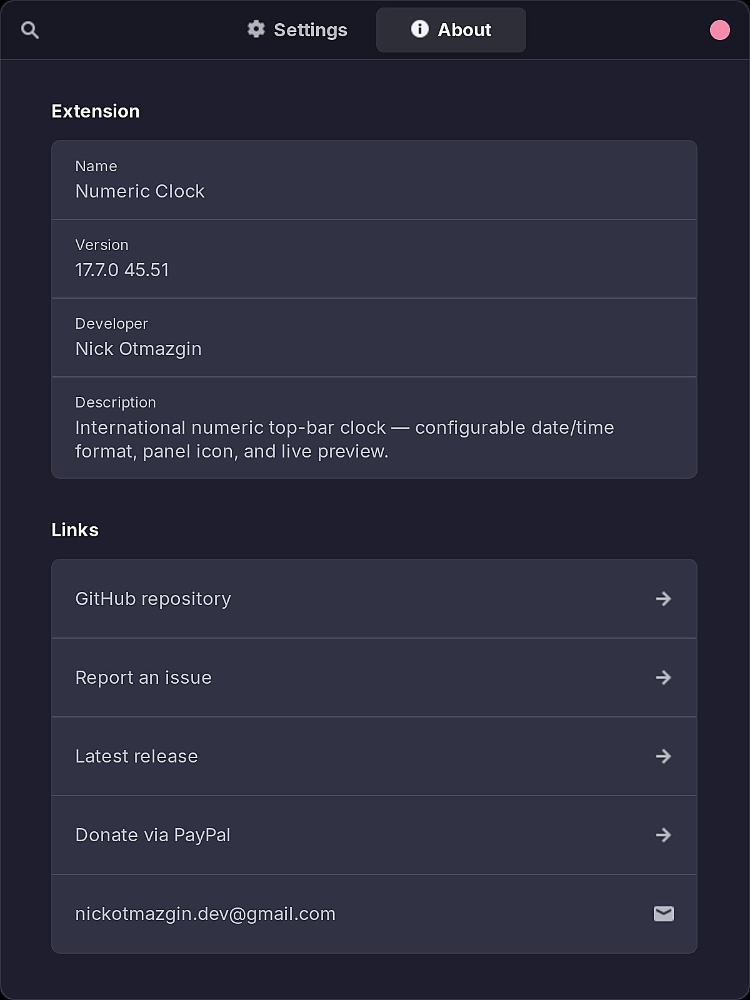</a><br>
      About
    </td>
  </tr>
</table>

---

## Features

* Fully numeric date/time — you choose the `strftime` **format string**
* **International defaults:** `DD/MM/YYYY HH:MM:SS` (24-hour, seconds; uses your **system locale and timezone**)
* **8 format presets:** International, weekday, compact, time-only, ISO 8601, ISO + week number, US 12-hour, top-bar only — each shows a live sample
* **Live preview** in settings, a built-in **format codes** cheat sheet, and invalid formats flagged (the clock falls back to the default instead of going blank)
* Configurable **update interval** (1–300 seconds)
* **Smooth tick** — updates land exactly on each second boundary
* **Panel icon** — left-click for the quick menu (copy time, presets, menu style, Preferences, About, Donate), **right-click for Preferences**, **middle-click to copy the time** (both configurable); the hover tooltip shows the time and the click hints
* **Menu style** — System (follows the shell theme), Light or Dark
* **Right-click the formatted clock** for the same quick menu (left-click still opens GNOME calendar)
* **Restores the stock clock immediately** when disabled or uninstalled
* Safe plain-text rendering (no Pango markup)
* No network access, telemetry, or external services — see [PRIVACY.md](PRIVACY.md)

---

## Compatibility

| GNOME | Status | Extension version | Notes |
| ----- | ------ | ----------------: | ----- |
| **45–51** | **Supported** | 32 | ESM build; do not ship `schemas/gschemas.compiled` |
| **42–44** | **Discontinued** | — | No longer built or maintained |

| Session | Status | Notes |
| ------- | ------ | ----- |
| **X11 / Xorg** | **Supported · validated** | Runtime-tested on Zorin OS 18.1 / GNOME Shell 46 / X11 |
| **Wayland** | **Supported** | **v17.7.0** passes the nested GNOME Shell (Wayland) smoke test |

**Minimum requirement:** GNOME Shell **45** on a **Wayland or X11/Xorg** session.

> **Validation scope (v17.7.0):** runtime-tested on GNOME Shell 46 (X11 desktop and a nested Wayland shell via `tools/nested-smoke-test.sh`). GNOME 47–51 support follows the official porting guides; Numeric Clock uses none of the APIs they removed.

Works on **Zorin OS**, Ubuntu, Fedora, and other GNOME-based distributions that ship Shell 45–51.

---

## Install

### From GitHub release (recommended)

Download **`numeric-clock@nickotmazgin.v32.shell-extension.zip`** from the [latest release](https://github.com/nickotmazgin/Linux-Numeric-Date-And-Clock/releases/latest) (or `gh release download -R nickotmazgin/Linux-Numeric-Date-And-Clock`), then:

```bash
gnome-extensions install --force numeric-clock@nickotmazgin.v32.shell-extension.zip
gnome-extensions enable numeric-clock@nickotmazgin
gnome-extensions prefs numeric-clock@nickotmazgin
```

### Build locally

```bash
./tools/build.sh
./tools/validate.sh
gnome-extensions install --force dist/numeric-clock@nickotmazgin.v32.shell-extension.zip
gnome-extensions enable numeric-clock@nickotmazgin
```

> **Note:** Release ZIPs **must not** contain `schemas/gschemas.compiled`.

After install, restart GNOME Shell: **Alt+F2** → `r` → Enter (Xorg) or log out/in (Wayland).

---

## Usage

Open **Preferences** and set:

* **Format string** — any `strftime` pattern
* **Update interval (seconds)** — use `1` when showing seconds
* **Smooth tick** — align updates to second boundaries
* **Only change the top bar clock** — leave other panel/dock clocks alone (recommended)
* **Menu style** — System, Light or Dark
* **Show panel icon** — clock icon for the quick menu
* **Panel icon clicks** — choose what right-click and middle-click do (quick menu, Preferences, copy time)
* **Right-click clock for quick menu** — secondary/middle click on the formatted clock

Settings apply immediately. The **format string** is saved when you press **Enter** (or the ✓ button), so a stray key press never changes your clock; the preview shows what you type before you apply it.

**Quick access:**

* **Left-click** the panel clock icon for the quick menu, **right-click** it for Preferences, **middle-click** it to copy the time
* The quick menu also has **About Numeric Clock** (opens Preferences on the About page) and **Donate**
* **Right-click** or **middle-click** the formatted top-bar clock for the same menu
* **Left-click** the clock still opens the standard GNOME calendar

### Regional examples

Numeric Clock uses your **system timezone** — set it in OS Settings. Examples:

**Europe / DD/MM (24-hour):**

```bash
gsettings set org.gnome.shell.extensions.numeric-clock format-string '%d/%m/%Y %H:%M:%S'
```

**ISO 8601 (worldwide standard):**

```bash
gsettings set org.gnome.shell.extensions.numeric-clock format-string '%Y-%m-%d %H:%M:%S'
```

**US (12-hour):**

```bash
gsettings set org.gnome.shell.extensions.numeric-clock format-string '%m/%d/%Y %I:%M:%S %p'
```

Or use the matching **preset buttons** in Preferences.

### Quick `strftime` cheatsheet

`%A` weekday · `%a` short weekday · `%d` day · `%m` month · `%Y` year · `%H` hour (00–23) · `%I` hour (01–12) · `%p` AM/PM · `%M` minute · `%S` second · `%V` ISO week · `%j` day of year · `%Z` time zone

Examples:

* `%d/%m/%Y %H:%M:%S` → `30/05/2026 18:20:06`
* `%Y-%m-%d %H:%M:%S` → `2026-05-30 18:20:06`
* `%m/%d/%Y %I:%M:%S %p` → `05/30/2026 06:20:06 PM`

---

## FAQ

**How do I show the date as DD/MM/YYYY in the GNOME top bar?**
Install Numeric Clock — the default format is `%d/%m/%Y %H:%M:%S`. GNOME itself has no date-format setting for the top bar.

**How do I show seconds in the GNOME clock?**
Use any format with `%S` (the default does) and keep *Update interval* at `1` with *Smooth tick* on.

**Can I use ISO 8601 (YYYY-MM-DD) or show the week number?**
Yes — use the *ISO 8601* or *ISO date + week number* preset, or type `%Y-%m-%d W%V %H:%M`.

**Does it work on Wayland and X11, Ubuntu, Fedora, Zorin OS?**
Yes, on any distribution with GNOME Shell 45–51, in Wayland and X11/Xorg sessions.

**Can I change what right-click and middle-click on the icon do?**
Yes — Preferences → *Panel icon clicks*: quick menu, Preferences, or copy the current time. Left-click always opens the quick menu.

**Can the menu be light or dark regardless of my theme?**
Yes — *Menu style* in Preferences or in the quick menu: System, Light or Dark.

**Does it change my timezone or locale?**
No. It only changes how the top-bar text looks; the time, timezone and month/day names come from your system settings.

**Does it send any data anywhere?**
No network access and no telemetry — see [PRIVACY.md](PRIVACY.md).

---

## Troubleshooting

**Clock missing or doubled?**

```bash
gnome-extensions list | grep -Ei 'clock|date|time'
gnome-extensions disable <conflicting-extension-uuid>
```

**Reset preferences:**

```bash
gsettings reset-recursively org.gnome.shell.extensions.numeric-clock
```

**Check status:**

```bash
gnome-extensions info numeric-clock@nickotmazgin
gnome-extensions list --enabled
```

**Logs:**

```bash
journalctl --user -b 0 -o cat | grep -i numeric-clock
```

---

## Packaging & releases (maintainers)

```bash
./tools/build.sh                # -> dist/numeric-clock@nickotmazgin.v32.shell-extension.zip (GNOME 45–51)
./tools/validate.sh
./tools/nested-smoke-test.sh    # isolated nested GNOME Shell run; prints PASSED/FAILED
./tools/prefs-test.sh           # Preferences behaviour in plain gjs
python3 tools/media/demo_video.py  # narrated 1080p demo video (tools/media/README.md)
npx -y eslint@9 .               # lint (same as CI)
```

Tag `v*` to trigger CI upload of ZIPs to GitHub Releases.

Do **not** commit `schemas/gschemas.compiled` to the repo. See [CONTRIBUTING.md](CONTRIBUTING.md) for the file layout.

---

## Privacy & compliance

* **Privacy:** [PRIVACY.md](PRIVACY.md) — local-only, no network, no telemetry
* **Security:** [SECURITY.md](SECURITY.md) — coordinated disclosure
* **License:** MIT — see [LICENSE](LICENSE)

This extension modifies only the top-bar clock display via supported GNOME Shell APIs. It does not bypass security, escalate privileges, or access data outside your session.

---

## License

MIT © Nick Otmazgin — see [LICENSE](LICENSE).

---

## Support

[](https://www.paypal.com/donate/?hosted_button_id=4HM44VH47LSMW)

---

## Contact

[nickotmazgin.dev@gmail.com](mailto:nickotmazgin.dev@gmail.com)

---

## Credits & Acknowledgements

Numeric Clock is created, maintained, signed, and released by **[Nick Otmazgin](https://github.com/nickotmazgin)** — the project's sole administrator and solo developer, who authors and reviews all code that ships.

[](https://claude.com/claude-code)
[](https://openai.com/codex/)

Recent releases were built with help from AI pair-programming agents, operated under the maintainer's direction and review:

- **OpenAI Codex** — release engineering, signed-tag release workflows, release validation and CI hardening
- **Cursor (Agent)** — code review, debugging, documentation
- **Claude** by Anthropic ([@claude](https://github.com/claude), via [Claude Code](https://claude.com/claude-code)) — v17.5.0 audit: GNOME 51 port, second-accurate ticking, safer clock detection, redrawn icon, rebuilt preferences, nested-shell smoke test, lint CI; v17.6.0 menu styles and panel icon clicks

Every AI-assisted change is human-reviewed, tested on real GNOME sessions, and approved by the maintainer before release. See [CONTRIBUTORS.md](CONTRIBUTORS.md) for the full credits.

> OpenAI and Codex are trademarks of OpenAI. Cursor is a trademark of Anysphere, Inc. Claude and Claude Code are trademarks of Anthropic, PBC. These names are used here solely for factual attribution. Numeric Clock is an independent project and is **not** affiliated with, sponsored, or endorsed by OpenAI, Anysphere/Cursor, or Anthropic.

---

## Find this project

**GitHub topics:** `gnome` · `gnome-shell` · `gnome-shell-extension` · `gnome-extension` · `linux` · `linux-desktop` · `clock` · `date-format` · `datetime` · `numeric-date` · `iso8601` · `24-hour` · `seconds` · `strftime` · `top-bar` · `wayland` · `x11` · `ubuntu` · `fedora` · `open-source`

**Search for:** GNOME numeric clock, GNOME top bar date format, change GNOME clock format, DD/MM/YYYY clock GNOME, ISO 8601 clock Linux, GNOME clock seconds, 24 hour clock GNOME, GNOME week number top bar

**Also:** [Demo video](#demo-video) · [YouTube](https://youtu.be/VlcEy6rQHBw) · [DEV article](https://dev.to/nickotmazgin/numeric-clock-176-a-numeric-date-and-time-for-the-gnome-top-bar-now-with-gnome-51-menu-styles-51oh) · [v17.6.0 announcement](https://github.com/nickotmazgin/Linux-Numeric-Date-And-Clock/discussions/76) · [Overview & downloads discussion](https://github.com/nickotmazgin/Linux-Numeric-Date-And-Clock/discussions/9) · [Releases](https://github.com/nickotmazgin/Linux-Numeric-Date-And-Clock/releases) · [Changelog](CHANGELOG.md)

## More GNOME extensions by Nick Otmazgin

- [ClipFlow Pro](https://github.com/nickotmazgin/clipflow-pro) — clipboard history manager with pins, stars & privacy
- [Comfort Control (EaseHub)](https://github.com/nickotmazgin/comfort-control-easehub) — panel menu for power, screenshots, updates & utilities
