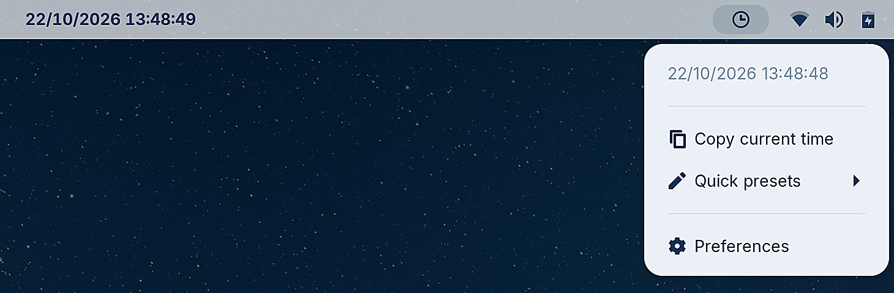
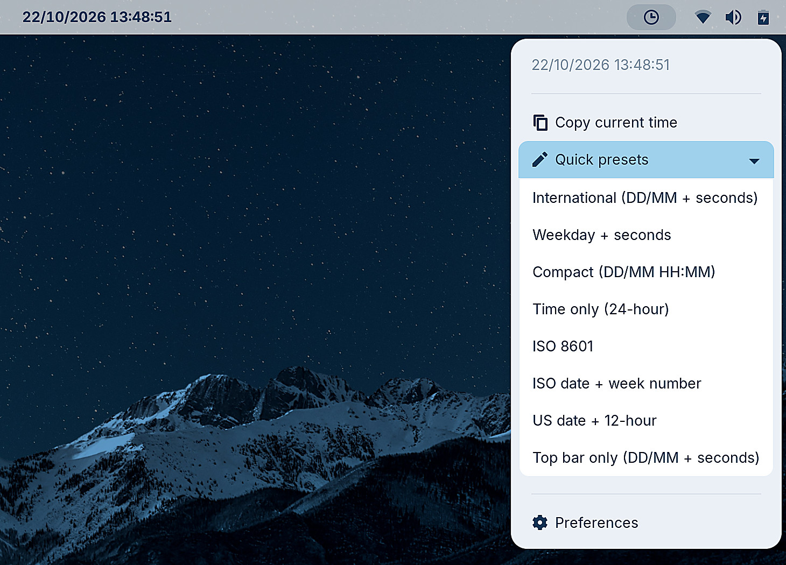
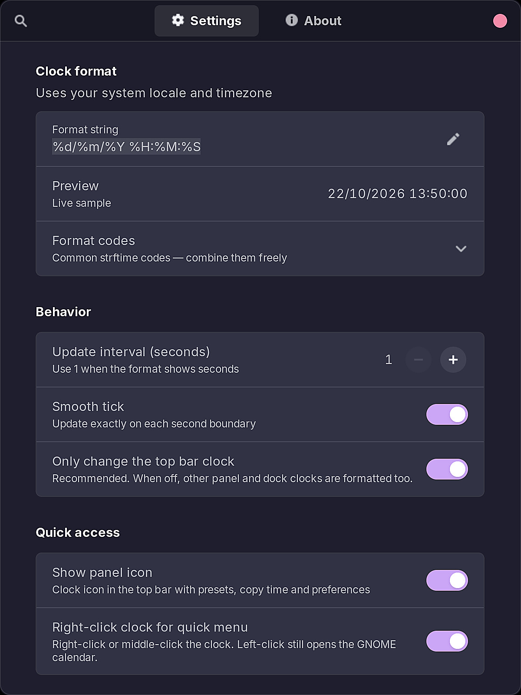
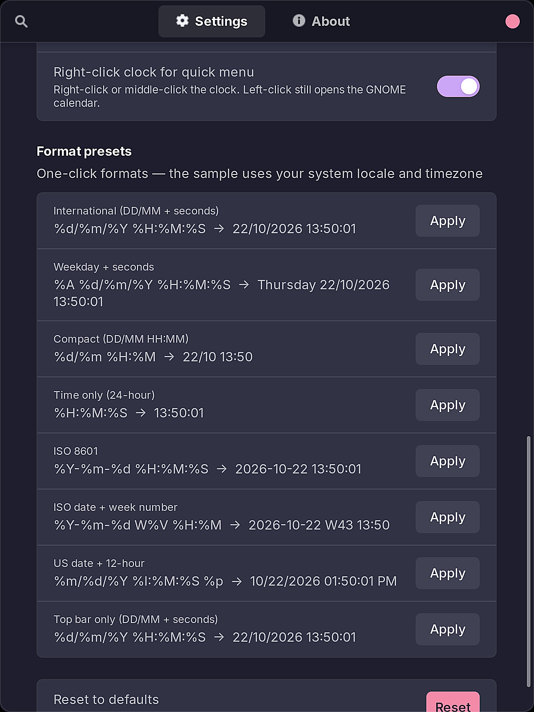

# Numeric Clock (GNOME Shell Extension)

[](https://github.com/nickotmazgin/Linux-Numeric-Date-And-Clock/releases/latest)
[](https://github.com/nickotmazgin/Linux-Numeric-Date-And-Clock/actions)
[](https://github.com/nickotmazgin/Linux-Numeric-Date-And-Clock/releases)
[](LICENSE)
[](#compatibility)
[](#compatibility)
[](#compatibility)
[](#compatibility)

[](https://github.com/nickotmazgin/Linux-Numeric-Date-And-Clock/issues)
[](https://github.com/nickotmazgin/Linux-Numeric-Date-And-Clock/discussions)
[](#features)

A lightweight GNOME Shell extension that replaces the top-bar clock with a **numeric, fully configurable** format — ideal for **DD/MM/YYYY**, **ISO 8601**, **24-hour**, or **12-hour** time with optional **seconds**, anywhere in the world.

**Latest:** v17.5.0 — ESM build v29 for **GNOME 45–51** (**X11/Xorg validated** on Zorin OS 18.1 / GNOME Shell 46)

> Download [v17.5.0](https://github.com/nickotmazgin/Linux-Numeric-Date-And-Clock/releases/latest). Older stable releases are kept for rollback. See [CHANGELOG.md](CHANGELOG.md) for what changed.

**UUID:** `numeric-clock@nickotmazgin`

> **Keywords:** GNOME clock · numeric date · DD/MM/YYYY · ISO 8601 · 24-hour time · Wayland · X11 · Xorg · top bar · Linux desktop · open source

> **GNOME Shell 42–44 is no longer supported.** Numeric Clock requires **GNOME 45–51**.

---

## Quick links

* **Latest release (ZIPs):** [GitHub Releases](https://github.com/nickotmazgin/Linux-Numeric-Date-And-Clock/releases/latest)
* **Privacy:** [PRIVACY.md](PRIVACY.md)
* **Security:** [SECURITY.md](SECURITY.md)
* **Support:** [SUPPORT.md](.github/SUPPORT.md) · **Contributing:** [CONTRIBUTING.md](CONTRIBUTING.md)
* **Issues:** [Report a bug](https://github.com/nickotmazgin/Linux-Numeric-Date-And-Clock/issues)
* **Discussions:** [Ask a question](https://github.com/nickotmazgin/Linux-Numeric-Date-And-Clock/discussions)

---

## Screenshots

*Numeric Clock v17.4.4 — click any image to view it full size.*

[](screenshots/collage.jpg)

<table>
  <tr>
    <td align="center">
      <a href="screenshots/c1.jpg"></a><br>
      <b>c1</b> — Panel icon menu
    </td>
    <td align="center">
      <a href="screenshots/c2.jpg"></a><br>
      <b>c2</b> — Quick presets
    </td>
    <td align="center">
      <a href="screenshots/c3.jpg"></a><br>
      <b>c3</b> — Preferences · Settings
    </td>
  </tr>
  <tr>
    <td align="center">
      <a href="screenshots/c4.jpg"></a><br>
      <b>c4</b> — Format presets
    </td>
    <td align="center">
      <a href="screenshots/c5.jpg"></a><br>
      <b>c5</b> — About
    </td>
  </tr>
</table>

---

## Features

* Fully numeric date/time — you choose the `strftime` **format string**
* **International defaults:** `DD/MM/YYYY HH:MM:SS` (24-hour, seconds; uses your **system locale and timezone**)
* **8 format presets:** International, weekday, compact, time-only, ISO 8601, ISO + week number, US 12-hour, top-bar only — each shows a live sample
* **Live preview** in settings, a built-in **format codes** cheat sheet, and invalid formats flagged (the clock falls back to the default instead of going blank)
* Configurable **update interval** (1–300 seconds)
* **Smooth tick** — updates land exactly on each second boundary
* **Panel access icon** — clock icon (with a live-time tooltip) opens a quick menu: presets, copy time, preferences
* **Right-click the formatted clock** for the same quick menu (left-click still opens GNOME calendar)
* **Restores the stock clock immediately** when disabled or uninstalled
* Safe plain-text rendering (no Pango markup)
* No network access, telemetry, or external services — see [PRIVACY.md](PRIVACY.md)

---

## Compatibility

| GNOME | Status | Extension version | Notes |
| ----- | ------ | ----------------: | ----- |
| **45–51** | **Supported** | 29 | ESM build; do not ship `schemas/gschemas.compiled` |
| **42–44** | **Discontinued** | — | No longer built or maintained |

| Session | Status | Notes |
| ------- | ------ | ----- |
| **X11 / Xorg** | **Supported · validated** | Runtime-tested on Zorin OS 18.1 / GNOME Shell 46 / X11 |
| **Wayland** | **Supported** | **v17.5.0** passes the nested GNOME Shell (Wayland) smoke test |

**Minimum requirement:** GNOME Shell **45** on a **Wayland or X11/Xorg** session.

> **Validation scope (v17.5.0):** runtime-tested on GNOME Shell 46 (X11 desktop and a nested Wayland shell via `tools/nested-smoke-test.sh`). GNOME 47–51 support follows the official porting guides; Numeric Clock uses none of the APIs they removed.

Works on **Zorin OS**, Ubuntu, Fedora, and other GNOME-based distributions that ship Shell 45–51.

---

## Install

### From GitHub release (recommended)

```bash
gnome-extensions install --force numeric-clock@nickotmazgin.v29.shell-extension.zip
gnome-extensions enable numeric-clock@nickotmazgin
gnome-extensions prefs numeric-clock@nickotmazgin
```

### Build locally

```bash
./tools/build.sh
./tools/validate.sh
gnome-extensions install --force dist/numeric-clock@nickotmazgin.v29.shell-extension.zip
gnome-extensions enable numeric-clock@nickotmazgin
```

> **Note:** Release ZIPs **must not** contain `schemas/gschemas.compiled`.

After install, restart GNOME Shell: **Alt+F2** → `r` → Enter (Xorg) or log out/in (Wayland).

---

## Usage

Open **Preferences** and set:

* **Format string** — any `strftime` pattern
* **Update interval (seconds)** — use `1` when showing seconds
* **Smooth tick** — align updates to second boundaries
* **Only change the top bar clock** — leave other panel/dock clocks alone (recommended)
* **Show panel icon** — clock icon for the quick menu
* **Right-click clock for quick menu** — secondary/middle click on the formatted clock

Changes apply immediately as you type.

**Quick access:**

* Click the **panel clock icon** (system tray area) for preferences, presets, and copy time
* **Right-click** or **middle-click** the formatted top-bar clock for the same menu
* **Left-click** the clock still opens the standard GNOME calendar

### Regional examples

Numeric Clock uses your **system timezone** — set it in OS Settings. Examples:

**Europe / DD/MM (24-hour):**

```bash
gsettings set org.gnome.shell.extensions.numeric-clock format-string '%d/%m/%Y %H:%M:%S'
```

**ISO 8601 (worldwide standard):**

```bash
gsettings set org.gnome.shell.extensions.numeric-clock format-string '%Y-%m-%d %H:%M:%S'
```

**US (12-hour):**

```bash
gsettings set org.gnome.shell.extensions.numeric-clock format-string '%m/%d/%Y %I:%M:%S %p'
```

Or use the matching **preset buttons** in Preferences.

### Quick `strftime` cheatsheet

`%A` weekday · `%a` short weekday · `%d` day · `%m` month · `%Y` year · `%H` hour (00–23) · `%I` hour (01–12) · `%p` AM/PM · `%M` minute · `%S` second · `%V` ISO week · `%j` day of year · `%Z` time zone

Examples:

* `%d/%m/%Y %H:%M:%S` → `30/05/2026 18:20:06`
* `%Y-%m-%d %H:%M:%S` → `2026-05-30 18:20:06`
* `%m/%d/%Y %I:%M:%S %p` → `05/30/2026 06:20:06 PM`

---

## Troubleshooting

**Clock missing or doubled?**

```bash
gnome-extensions list | grep -Ei 'clock|date|time'
gnome-extensions disable <conflicting-extension-uuid>
```

**Reset preferences:**

```bash
gsettings reset-recursively org.gnome.shell.extensions.numeric-clock
```

**Check status:**

```bash
gnome-extensions info numeric-clock@nickotmazgin
gnome-extensions list --enabled
```

**Logs:**

```bash
journalctl --user -b 0 -o cat | grep -i numeric-clock
```

---

## Packaging & releases (maintainers)

```bash
./tools/build.sh                # -> dist/numeric-clock@nickotmazgin.v29.shell-extension.zip (GNOME 45–51)
./tools/validate.sh
./tools/nested-smoke-test.sh    # isolated nested GNOME Shell run; prints PASSED/FAILED
npx -y eslint@9 .               # lint (same as CI)
```

Tag `v*` to trigger CI upload of ZIPs to GitHub Releases.

Do **not** commit `schemas/gschemas.compiled` to the repo. See [CONTRIBUTING.md](CONTRIBUTING.md) for the file layout.

---

## Privacy & compliance

* **Privacy:** [PRIVACY.md](PRIVACY.md) — local-only, no network, no telemetry
* **Security:** [SECURITY.md](SECURITY.md) — coordinated disclosure
* **License:** MIT — see [LICENSE](LICENSE)

This extension modifies only the top-bar clock display via supported GNOME Shell APIs. It does not bypass security, escalate privileges, or access data outside your session.

---

## License

MIT © Nick Otmazgin — see [LICENSE](LICENSE).

---

## Support

[](https://www.paypal.com/donate/?hosted_button_id=4HM44VH47LSMW)

---

## Contact

[nickotmazgin.dev@gmail.com](mailto:nickotmazgin.dev@gmail.com)

---

## Credits & Acknowledgements

Numeric Clock is created, maintained, signed, and released by **[Nick Otmazgin](https://github.com/nickotmazgin)** — the project's sole administrator and solo developer, who authors and reviews all code that ships.

[](https://claude.com/claude-code)
[](https://openai.com/codex/)

Recent releases were built with help from AI pair-programming agents, operated under the maintainer's direction and review:

- **OpenAI Codex** — release engineering, signed-tag release workflows, release validation and CI hardening
- **Cursor (Agent)** — code review, debugging, documentation
- **Claude** by Anthropic ([@claude](https://github.com/claude), via [Claude Code](https://claude.com/claude-code)) — v17.5.0 audit: GNOME 51 port, second-accurate ticking, safer clock detection, redrawn icon, rebuilt preferences, nested-shell smoke test, lint CI

Every AI-assisted change is human-reviewed, tested on real GNOME sessions, and approved by the maintainer before release. See [CONTRIBUTORS.md](CONTRIBUTORS.md) for the full credits.

> OpenAI and Codex are trademarks of OpenAI. Cursor is a trademark of Anysphere, Inc. Claude and Claude Code are trademarks of Anthropic, PBC. These names are used here solely for factual attribution. Numeric Clock is an independent project and is **not** affiliated with, sponsored, or endorsed by OpenAI, Anysphere/Cursor, or Anthropic.

---

## Find this project

**GitHub topics:** `gnome-shell-extension` · `clock` · `24-hour` · `numeric-date` · `top-bar` · `seconds` · `wayland` · `x11` · `xorg` · `linux` · `open-source`

**Search for:** GNOME numeric clock, Linux top bar date format, DD/MM/YYYY clock extension, 24 hour clock GNOME

## More GNOME extensions by Nick Otmazgin

- [ClipFlow Pro](https://github.com/nickotmazgin/clipflow-pro) — clipboard history manager with pins, stars & privacy
- [Comfort Control (EaseHub)](https://github.com/nickotmazgin/comfort-control-easehub) — panel menu for power, screenshots, updates & utilities
